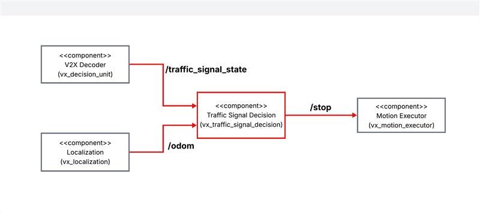

[Ravikumar Shivlal Savaliya](https://git.hs-coburg.de/ravisavaliya) : Traffic Signal Decision
---

## 📌 Table of Contents

- [Overview](#-overview)
- [Component Architecture](#-component-architecture)
- [ROS 2 Topics](#-ros-2-topics)
- [Component Functionalities](#-component-functionalities)
- [Installation & Setup](#-installation--setup)
- [Interface Test Procedure](#-interface-test-procedure)

---

## 📖 Overview

The **Traffic Signal Decision** helps the vehicle decide whether it should stop or keep driving when it approaches an intersection. It looks at where the vehicle is located and which direction it is facing, using predefined areas (Regions of Interest or ROIs) for each intersection. It checks the current traffic signal at the intersection to see if it is red (stop) or green (go), and tells the vehicle whether to stop or continue moving.

The module uses:
- **Vehicle position and orientation** data from `/odom`.
- **Traffic signal state** from `/traffic_signal_state`.
- **Predefined intersection zones** (ROIs) and their associated signal groups.

---

## 🏗️ Component Architecture



---

## 🔌 ROS 2 Topics

| IN/Out | Topic Name               | Message Type                  | Description                                                                                           |
|--------|--------------------------|-------------------------------|-------------------------------------------------------------------------------------------------------|
| Input  | `/odom`                  | `nav_msgs/Odometry`           | Current position and orientation of the ego vehicle.                                                   |
| Input  | `/traffic_signal_state`  | `vx_custom_msgs/TrafficSignalState` | Receives the signal state and event state of the traffic signal at the active intersection.            |
| Output | `/stop`                  | `std_msgs/Bool`               | Publishes a stop/go command: **True = stop**, **False = go**, based on the traffic signal state and vehicle position. |

---------
## User Story & Acceptance Criteria

US 3.2: As the Traffic Signal Decision module, I want to determine if the ego-vehicle is inside predefined Regions of Interest (ROIs) representing intersection zones based on vehicle position and heading, so that I can identify the active intersection and signal group.


- A.C. 3.2.1 The Traffic Signal Decision module shall subscribe to `/traffic_signal_state` and `/odom` topics.
- A.C. 3.2.2 The Traffic Signal Decision module shall convert the ego-vehicle orientation from quaternion to heading in degrees [0°, 360°).
- A.C. 3.2.3 The Traffic Signal Decision module shall check if the ego-vehicle position lies inside any predefined bounding box (ROI) for each signal group.
- A.C. 3.2.4 The Traffic Signal Decision module shall check if the ego-vehicle heading is within the allowed heading range associated with the bounding box.
- A.C. 3.2.5 If both position and heading match, the module records the corresponding `intersection_id` and `signal_group_id` as active.

---

US 3.3: As the Traffic Signal Decision module, I want to evaluate the event state of the active signal group received from TrafficSignalState messages so that I can decide whether the ego vehicle should stop or go.

- A.C. 3.3.1 The Traffic Signal Decision module shall read the `event_state` of the associated `signal_group` from the TrafficSignalState message.
- A.C. 3.3.2 The Traffic Signal Decision module shall map the received `event_state` values to colors:
   - 5 → GREEN
   - 3, 4, 7 → RED
   - others → UNKNOWN
- A.C. 3.3.3 The Traffic Signal Decision module evaluates the event state only if it matches the current active `intersection_id` and `signal_group_id`.
- A.C. 3.3.4 When the color of active `intersection_id` and `signal_group_id` is RED or UNKNOWN, the Traffic Signal Decision module shall publish **True** on the `/stop` topic.
- A.C. 3.3.5 When the color of active `intersection_id` and `signal_group_id` is GREEN, the Traffic Signal Decision module shall publish **False** on the `/stop` topic.
- A.C. 3.3.6 When the traffic signal transitions from RED to GREEN, the Traffic Signal Decision module shall publish **False** on the `/stop` topic to command the Motion Executor to resume motion.


## ⚙️ Component Functionalities(Algorithm)

The **Traffic Signal Decision** module continuously monitors the ego-vehicle’s position and orientation to determine its location relative to predefined Regions of Interest (ROIs) associated with different signal groups at intersections. The module subscribes to the `/odom` topic for real-time vehicle position and heading, and the `/traffic_signal_state` topic for the state of the traffic signals.

Once it receives the vehicle's position and orientation, the module checks if the ego-vehicle is within any of the predefined bounding boxes (ROIs) for each signal group. It also evaluates if the vehicle's heading is within the allowed range for that specific intersection zone.

After identifying the active intersection and signal group, the module reads the corresponding event state from the `TrafficSignalState` message, which indicates whether the traffic signal is GREEN, RED, or UNKNOWN. Based on the event state, the module decides whether the vehicle should stop or go.

To ensure smooth operation, the **Traffic Signal Decision** module checks both the vehicle's position and heading to confirm the active intersection, and it makes stop/go decisions based on the traffic signal's color.

Once the decision is made, the module publishes a `True` or `False` value on the `/stop` topic. **True** indicates that the vehicle should stop, while **False** indicates that the vehicle can proceed.

This approach ensures that the vehicle always responds appropriately to traffic signal states while considering its position and heading relative to the intersection.

---

## Dependencies

1. [vx_localization](https://git.hs-coburg.de/voyagex/vx_localization)
2. [vx_custom_msgs](https://git.hs-coburg.de/voyagex/vx_custom_msgs)
3. [vx_v2x_decoder](https://git.hs-coburg.de/voyagex/vx_v2x_decoder)

## 📥 Installation & Setup

### 🔧 Clone the repository

```bash
git clone https://git.hs-coburg.de/voyagex/vx_traffic_signal_decision.git
```

##  Build the package
```bash
cd vx_path_planning
colcon build
source install/setup.bash

```

 ## Run the node
```bash
ros2 run vx_traffic_signal_decision traffic_signal_decision_node
```

 ## 🧪 Interface Test Procedure

This section outlines how to verify that the **Traffic Signal Decision** correctly subscribes to inputs and publishes the expected path output using ROS 2 topics.


### Step-by-Step Test Procedure

1. **Launch the Node**
   ```bash
   ros2 run vx_traffic_signal_decision traffic_signal_decision_node
   ```
   
2. **Run Unit Tests**
   ```bash
   python3 -m pytest -v src/traffic_signal_decision/test/traffic_test.py
   ```

3. **Run Tests with Coverage**
   ```bash
   python3 -m coverage run --source=traffic_signal_decision -m pytest src/traffic_signal_decision/test/traffic_test.py
   ```

4. **Show Coverage Report**
   ```bash
   python3 -m coverage report -m install/traffic_signal_decision/lib/python3.10/site-packages/traffic_signal_decision/traffic_signal_decision_node.py
   ```
 
5. **Generate HTML Coverage Report**
   ```bash
   python3 -m coverage html --directory=src/traffic_signal_decision/test/htmlcov
   ```

